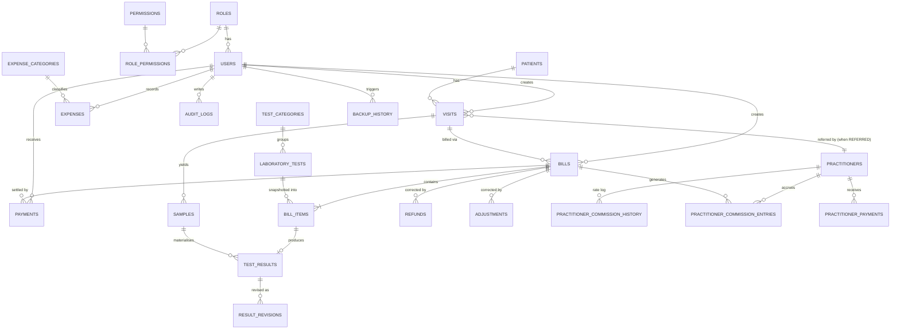

# DATABASE.md — Schema, Relationships & Conventions

Engine: SQLite (single file `lmas.db`), WAL mode, foreign keys ON.
Schema version tracking: `PRAGMA user_version` (currently **1**).

## 1. Conventions

| Convention | Rule |
| --- | --- |
| Money | `INTEGER` **paisa** (1 PKR = 100 paisa). Column suffix `_paisa`. |
| Commission rate | `INTEGER` **basis points** (50% = 5000). Suffix `_bp`. |
| Timestamps | `TEXT` `'YYYY-MM-DD HH:MM:SS'` **local time**. |
| Business dates | `TEXT` `'YYYY-MM-DD'` (bill_date, visit_date, expense_date). |
| Codes | Human-friendly unique codes (`patient_code`, `bill_number`, `transaction_id`, …) alongside numeric PKs. |
| Deletion | Financial rows are never deleted by the app; corrections use `adjustments` / `refunds`. |
| History preservation | `bill_items` snapshots test name/code/list price/charged price/direct cost; `bills` snapshots rate & basis; `practitioner_commission_history` logs rate changes. |

## 2. Entity-relationship diagram

Key attributes (PK unless noted):

- **users** — username (unique), password_hash, role_id→roles, is_active,
  must_change_password, last_login_at.
- **patients** — patient_code (unique), full_name, full_name_urdu, age, gender,
  phone, address.
- **visits** — visit_code, patient_id→patients, category `SELF|REFERRED`,
  practitioner_id (nullable, required for REFERRED — CHECK), visit_date.
- **practitioners** — practitioner_code, name, clinic_name, commission_rate_bp,
  is_active.
- **practitioner_commission_history** — practitioner_id, rate_bp,
  effective_from, changed_by, reason.
- **laboratory_tests** — test_code, name, category_id, price_paisa,
  direct_cost_paisa (optional), sample_type, tat_hours, is_active.
- **bills** — bill_number, visit_id, patient_id, category, practitioner_id,
  practitioner_rate_bp (snapshot), commission_basis, subtotal/discount/net/
  commission/lab_allocation `_paisa`, status (`DRAFT|FINALIZED|PARTIALLY_PAID|
  PAID|CANCELLED|REFUNDED`), bill_date, finalized_at.
- **bill_items** — bill_id, test_id, snapshot(test_name, test_code,
  list_price_paisa, price_paisa, direct_cost_paisa), line_total_paisa.
- **payments** — transaction_id (**unique** → duplicate guard), bill_id,
  amount_paisa > 0, method, reference_number, paid_at, received_by.
- **practitioner_commission_entries** — bill_id, practitioner_id, entry_type
  (`ACCRUAL|ADJUSTMENT|REVERSAL`), basis, rate_bp, eligible_paisa,
  commission_paisa (signed; negative for reversals).
- **practitioner_payments** — transaction_id (**unique**), practitioner_id,
  amount_paisa > 0, method, reference_number, paid_at, paid_by.
- **samples** — sample_code, visit_id, sample_type, status
  (`NOT_COLLECTED|COLLECTED|RECEIVED|REJECTED|PROCESSING|COMPLETED`),
  assigned_technician_id.
- **test_results** — bill_item_id, sample_id, status (`PENDING|IN_PROGRESS|
  COMPLETED|CANCELLED`), result_state (`DRAFT|VERIFIED|APPROVED`), value, unit,
  reference_range, observations, remarks, entered/verified/approved
  (by + at).
- **result_revisions** — result_id, revision_no (unique per result), full
  snapshot of editable fields, changed_by/at.
- **expenses** — expense_code, category_id→expense_categories, description,
  amount_paisa > 0, expense_date, method, reference_number.
- **adjustments** — bill_id, adjustment_type (`DISCOUNT_ADJUSTMENT|
  BILL_ADJUSTMENT|COMMISSION_REVERSAL`), signed amount_paisa, reason.
- **refunds** — bill_id, amount_paisa > 0, reason, method.
- **audit_logs** — user_id, action, entity_type, entity_id, old_value/new_value
  (JSON), reason, created_at.
- **application_settings** — key (PK), value, updated_at/by.
- **backup_history** — file_path, file_size, backup_type (`MANUAL|AUTO`),
  status, verified, created_by/at.
- **v_transaction_history** — VIEW unifying patient payments, commission
  payments, expenses, refunds, adjustments (PRD Module H).

## 3. Relationships (PRD §6.2 coverage)

- One patient → many visits; category lives on the **visit** (PRD §2.3).
- One visit → many bills (workflow allows split billing); one bill → many
  items; one bill → many payments.
- One practitioner → many referred visits, many commission entries, many
  commission payments.
- One visit → many samples; results join bill_item ↔ sample; one result →
  many revisions.
- Users create transactions and audit events; role permissions gate every
  module.

## 4. Integrity rules ↔ PRD §6.1

| PRD rule | Mechanism |
| --- | --- |
| 1. Unique IDs on every entity | `INTEGER PRIMARY KEY AUTOINCREMENT` + unique business codes |
| 2. Decimal-safe money | Integer paisa columns, CHECK `>= 0` on amounts |
| 3. Foreign keys enabled | `PRAGMA foreign_keys = ON` on every connection |
| 4. Transactions for financial ops | Services use `db.transaction()` |
| 5. Historical bill items preserved | Snapshot columns in `bill_items` |
| 6. Historical commission rate preserved | `bills.practitioner_rate_bp`, `practitioner_commission_entries.rate_bp/basis` |
| 7. Multiple visits per patient | 1:N patients→visits |
| 8. Visit carries category | `visits.category` CHECK |
| 9. Referred visits need practitioner | CHECK constraint |
| 10. Finalized bills not silently overwritten | No edit path in Checkpoint 1; adjustments/refunds tables reserved for Checkpoint 2+ workflows with audit |
| 11. Corrections traceable | `adjustments`, `refunds`, `audit_logs` |
| 12. Migrations preserve records | Transactional, append-only, `user_version` gated |

## 5. Numbering scheme (used from Checkpoint 2)

`{prefix}-{YYYY}-{0001}` with per-year sequence, prefixes configurable in
Settings (`numbering.billPrefix`, `numbering.patientPrefix`,
`numbering.reportPrefix`). Codes are generated in the main process inside the
same transaction as the financial write.

### Payment tender and patient advances (Migration 003)

`payments.amount_paisa` remains the amount actually applied to the bill. `payments.tendered_paisa` stores the full cash/bank amount received, and `payments.change_paisa` stores physical cash change returned. Existing payment rows are backfilled with `tendered_paisa = amount_paisa` and zero change.

Excess bank transfers are stored in `patient_advances`, linked to the originating payment and patient. `amount_paisa` is the original credit and `remaining_paisa` is the unapplied balance. The transaction history view exposes these as separate `PATIENT_ADVANCE` inflows. This release records advances but does not yet provide a workflow to apply an existing advance to a later bill.
